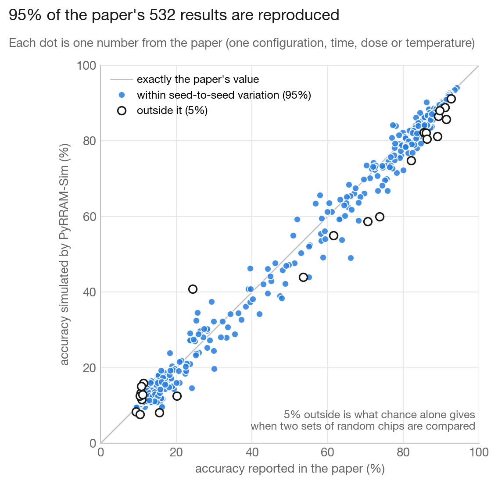
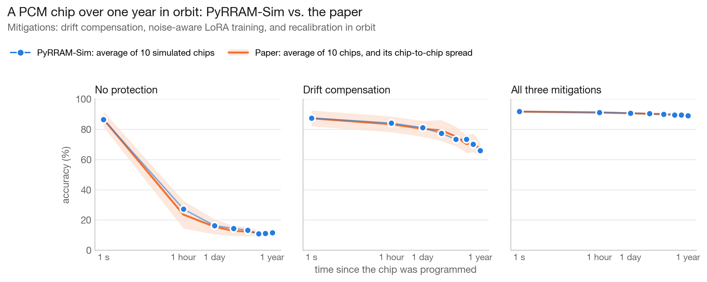

# Reproducing Selected Papers Using PyRRAM-Sim

PyRRAM-Sim contains everything needed to reproduce the main results of the papers below. For each paper, this page gives:

* the **commands** to run,
* what you **should see**,
* how close **our own run** came to the paper: one number, with a figure.

The tutorials explain the same commands step by step. Run everything from the `PyRRAM-Sim` folder, after the installation in the [README](../README.md#install). The data behind the figures is in [`docs/data/`](data/); `python docs/make_figures.py` redraws them.

| Paper | What you reproduce | Our result | Needs |
|---|---|---|---|
| [The simulator itself](#the-simulator-itself) | A perfect chip, and a chip with broken cells | Same accuracy as the normal network | laptop, 10 min |
| [HARD-DPO](#hard-dpo-tcad-2026) (IEEE TCAD 2026) [16] | How often an LLM changes its judgement on a chip, with and without HARD-DPO | Removes **92%** of the flips (paper: 94%) | 24 GB laptop or GPU, under an hour |
| [MoF-LoRA and HAT-FI](#mof-lora-and-hat-fi-jetcas-2026-vts-2026) (IEEE JETCAS 2026 [17], IEEE VTS 2026 [18]) | Experts that win back the accuracy lost to broken cells | From **10% to 90%** accuracy | laptop, 15 min |
| [Space Data Centers](#space-data-centers-coins-2026) (IEEE COINS 2026) [25] | The whole case study, Figs. 2-8 | **95%** of the paper's 532 results within seed-to-seed variation | NVIDIA GPUs, about 3.5 hours on 8 |

**Why results never match exactly.** Every simulated chip draws its own random errors, fixed by a *seed* (see [Concepts](concepts.md#7-randomness-seeds-and-reproduced)). Real chips also differ from each other, so papers report the average over several chips. Two sets of random chips give slightly different averages, even with the same simulator. A reproduction is therefore successful when the differences are no larger than this chip-to-chip (seed-to-seed) variation.

## The simulator itself

**Result:** a ResNet18 on a simulated 8-bit chip without errors reaches the same CIFAR-10 accuracy as the network on a normal computer (difference: one image in 10,000). Adding broken cells lowers it the way the literature describes.

### How to reproduce

```bash
# 1. a perfect 8-bit chip
python main.py --dataset-path ./data --n-levels 256

# 2. 1.2% broken cells, with 8 binary cells per weight
python main.py --dataset-path ./data --n-levels 2 --cells-per-weight 8 --apply-stuck-at --p-on 0.01 --p-off 0.002

# 3. 10.8% broken cells, as measured on a real test chip
python main.py --dataset-path ./data --n-levels 256 --apply-stuck-at --p-on 0.0904 --p-off 0.0175 --fault-seed 1
```

The first command downloads CIFAR-10 and a trained ResNet18. You should see about 95%, 92% and 10% (random guessing) on the chip, against 95% for the normal network.


The space models were also compared with IBM's aihwkit, the simulator the Space Data Centers paper used. On the same weights, the parts without randomness agree up to floating-point rounding, and the random parts follow the same statistics.

Explained step by step in [Tutorial 1](tutorials/1_first_simulation.md).

## HARD-DPO (TCAD 2026)

**Result:** HARD-DPO removes 92% of the preference flips; the paper reports 94%. With the paper's test (0.8% programming error), the instruction-tuned Qwen2.5-0.5B model flips 24% of the preference pairs on the chip (paper: 33%). The HARD-DPO model flips 2% (paper: 2%).

### How to reproduce

The paper's test (the evaluation protocol of the paper's released scripts):

```bash
# 1. the instruction-tuned model (paper: 33% flips)
python llm_main.py eval --legacy-eval --alphas 0.008 --chips 5 --batch-size 1 --max-length 2048 --low-memory

# 2. the HARD-DPO model (paper: 2% flips)
python llm_main.py eval --legacy-eval --alphas 0.008 --chips 5 --batch-size 1 --max-length 2048 --low-memory \
    --clip-sigma 3 --peft-adapter noise_robust_dpo_qwen2.5_0.5b.pt --lora-alpha 128 --deploy hybrid
```

Read the `flip rate` column. The first run downloads the model and the preference pairs (UltraFeedback).

The HARD-DPO model in command 2 (`noise_robust_dpo_qwen2.5_0.5b.pt`) was trained with the paper's own code ([HARD_DPO](https://github.com/SoyedTuhinAhmed/HARD_DPO), `noise_robust_dpo.py`). `--lora-alpha` must be the value it was trained with: 128 for the paper's model.

You can also train a HARD-DPO model with PyRRAM-Sim. Training for only 100 steps on a laptop already cuts the flips from 16% to about 1% in our standard test. See [Tutorial 3](tutorials/3_llm_alignment.md), steps 2-4.


**Why the difference.** The paper's test draws 50 preference pairs for each chip, and we ran 5 chips. That is few, and our confidence range for the instruction-tuned model (thin gray line) easily includes the paper's 33%. The HARD-DPO result is the same as the paper's.

## MoF-LoRA and HAT-FI (JETCAS 2026, VTS 2026)

**Result:** fault-tolerant experts bring a ResNet18 with 4% broken cells back from 10% (random guessing) to 90% accuracy. This is the central result of both papers: broken cells push an unprotected network off a cliff, and experts trained for the chip recover it. HAT-FI's selection of experts from the chip's own measurements (Sparse-MoF) also avoids the accuracy that MoF-LoRA loses on a healthy chip.

### How to reproduce

```bash
python mof_main.py --dataset-path ./data --steps 200 --chips 2
```

This trains the experts and tests three networks (unprotected, MoF-LoRA, Sparse-MoF) as the chip gets worse. In the last rows (`+prog+drift+SAF`, `+read`) the unprotected network should be at about 10% and both protected ones at about 90%. On a healthy chip (the `clean` row), Sparse-MoF should stay close to the unprotected network (about 95%), while MoF-LoRA loses about 6 points.


**What was not repeated.** This check uses a CIFAR-10 ResNet18 with 200 training steps per expert, not the papers' exact benchmarks, so it confirms the effect rather than the papers' individual numbers.

Explained step by step in [Tutorial 2](tutorials/2_fault_tolerant_experts.md); for LLMs, see [Tutorial 4](tutorials/4_llm_performance.md).

## Space Data Centers (COINS 2026)

**Result:** 95% of the paper's 532 results are reproduced within seed-to-seed variation. This is as good as a reproduction can be: two runs of the *same* simulator with different seeds also agree on about 95% of the points by this test. The reproduction flew the paper's own trained models through every configuration of Figs. 2-8.

### How to reproduce

On a Linux computer with NVIDIA GPUs, one script does everything, from downloading the data to the comparison with the paper:

```bash
bash scripts/sdc_coins26/00_setup.sh        # once: Python environment in .venv/
bash scripts/sdc_coins26/run_all.sh         # about 3.5 hours on 8 GPUs
```

`run_all.sh` runs these steps; you can also run them one by one:

```bash
bash scripts/sdc_coins26/01_download.sh     # EuroSAT images and the pretrained Presto model
bash scripts/sdc_coins26/02_build_cache.sh  # images into one fast file (1 minute)
bash scripts/sdc_coins26/smoke_test.sh      # quick check that everything works (3 minutes)
bash scripts/sdc_coins26/03_train.sh        # train the models for 10 seeds (about 1.5 hours on 8 GPUs)
bash scripts/sdc_coins26/04_missions.sh     # fly the missions (about 2 hours on 8 GPUs)
bash scripts/sdc_coins26/05_report.sh       # compare with the paper
```

For a first try, fly only Fig. 2 with one seed (about 10 minutes on 8 GPUs, after the training):

```bash
bash scripts/sdc_coins26/04_missions.sh --figures fig2 --seeds 0
```

The last line of `05_report.sh` is the headline:

```
532 points compared with the paper: ... |z| < 2 for 95%, |z| < 3 for 99%
```



Each dot is one number from the paper. Dots on the diagonal line are reproduced exactly.




**Why the remaining 5% differ.** We believe all of it comes from random seeds:

* **Chance.** When two sets of random chips are compared, about 1 point in 20 lands outside the range by chance alone.
* **Fewer chips.** To save computing time, the radiation and temperature sweeps (Figs. 6-8) used 2 chips per point instead of the paper's 10. Averages over 2 chips scatter more, and most of the points outside come from these sweeps.
* **Points at chance level.** Where every chip is at random guessing (10%), the paper's chip-to-chip spread is almost zero, so even a tiny difference counts as "outside".

One difference may not be chance: with drift compensation alone, after 12 months, our chips spread more than the paper's (their average is the same).

The training was reproduced as well: on the paper's hardware, the fine-tuning in `03_train.sh` recreated the paper's E0 models exactly (checked for two seeds).

Explained step by step, with all settings and troubleshooting, in [Tutorial 5](tutorials/5_space_ai.md).
