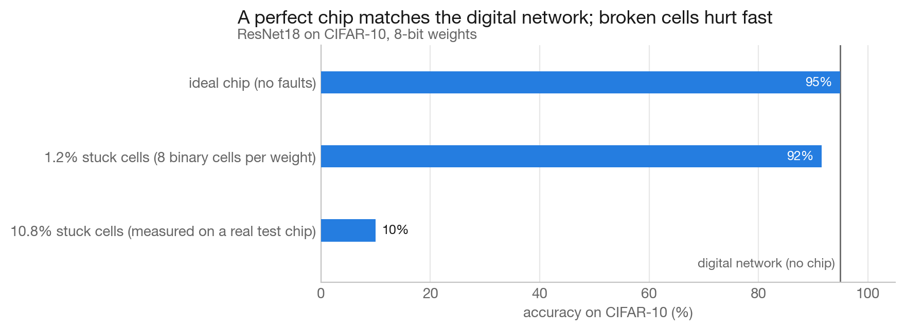
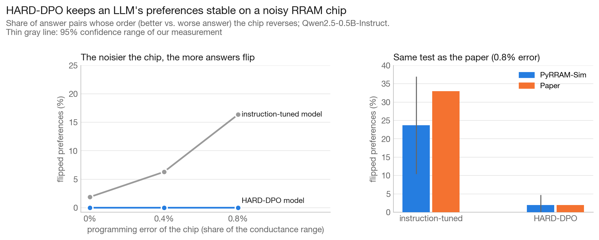
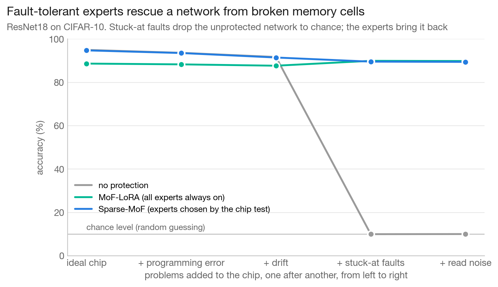
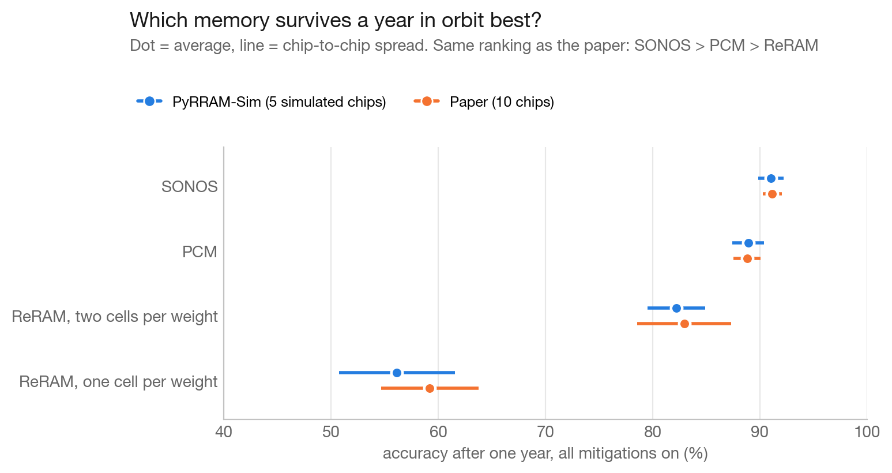
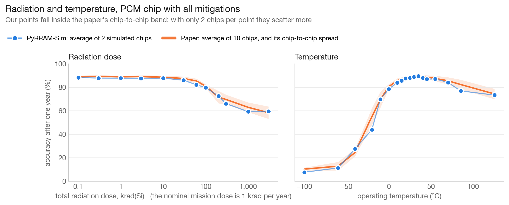

# Reproducing the Papers

PyRRAM-Sim was checked against each paper it implements. For every paper, this page gives **one number** that sums up how close the reproduction is, a figure, and the reason for the remaining differences. The data behind the figures is in [`docs/data/`](data/); `python docs/make_figures.py` redraws them.

**Why results never match exactly.** Every simulated chip draws its own random errors, fixed by a *seed* (see [Concepts](concepts.md#7-randomness-seeds-and-reproduced)). Real chips also differ from each other, so papers report the average over several chips. Two sets of random chips give slightly different averages, even with the same simulator. A reproduction is therefore successful when the differences are no larger than this chip-to-chip (seed-to-seed) variation.

| Paper | Headline | Details |
|---|---|---|
| The simulator itself | A perfect simulated chip gives the same accuracy as the digital network | [below](#the-simulator-itself) |
| HARD-DPO (IEEE TCAD 2026) [16] | HARD-DPO removes **92%** of the preference flips (paper: 94%) | [below](#hard-dpo-tcad-2026) |
| MoF-LoRA (IEEE JETCAS 2026) [17], HAT-FI (IEEE VTS 2026) [18] | Experts bring a network with broken cells back from **10% to 90%** accuracy | [below](#mof-lora-and-hat-fi-jetcas-2026-vts-2026) |
| Space Data Centers (IEEE COINS 2026) [25] | **95%** of the paper's 532 results reproduced within seed-to-seed variation | [below](#space-data-centers-coins-2026) |

## The simulator itself

A ResNet18 on a simulated 8-bit chip without errors reaches the same CIFAR-10 accuracy as the network on a normal computer (difference: one image in 10,000). Adding broken cells lowers it the way the literature describes. The space models were also compared with IBM's aihwkit, the simulator the Space Data Centers paper used: on the same weights, the parts without randomness agree up to floating-point rounding, and the random parts follow the same statistics.

Try it: [Tutorial 1](tutorials/1_first_simulation.md).

## HARD-DPO (TCAD 2026)

**HARD-DPO removes 92% of the preference flips; the paper reports 94%.** With the paper's test (0.8% programming error), the instruction-tuned Qwen2.5-0.5B model flips 24% of the preference pairs on the chip (paper: 33%). The HARD-DPO model (trained with the paper's own scripts) flips 2% (paper: 2%). A HARD-DPO model trained with PyRRAM-Sim for only 100 steps already cuts the flips from 16% to about 1% in our standard test.

**Why the difference.** The paper's test draws 50 preference pairs for each chip, and we ran 5 chips. That is few, and our confidence range for the instruction-tuned model (thin gray line) easily includes the paper's 33%. The HARD-DPO result is the same as the paper's.

Try it: [Tutorial 3](tutorials/3_llm_alignment.md).

## MoF-LoRA and HAT-FI (JETCAS 2026, VTS 2026)

**Fault-tolerant experts bring a ResNet18 with 4% broken cells back from 10% (random guessing) to 90% accuracy.** This is the central result of both papers: broken cells push an unprotected network off a cliff, and experts trained for the chip recover it. HAT-FI's telemetry-guided selection (Sparse-MoF) also avoids the accuracy that MoF-LoRA loses on a healthy chip.

**What was not repeated.** This check uses a CIFAR-10 ResNet18 with 200 training steps per expert, not the papers' exact benchmarks, so it confirms the effect rather than the papers' individual numbers.

Try it: [Tutorial 2](tutorials/2_fault_tolerant_experts.md) and, for LLMs, [Tutorial 4](tutorials/4_llm_performance.md).

## Space Data Centers (COINS 2026)

**95% of the paper's 532 results are reproduced within seed-to-seed variation.** This is as good as a reproduction can be: two runs of the *same* simulator with different seeds also agree on about 95% of the points by this test. The reproduction flew the paper's own trained models through every configuration of Figs. 2-8.

Each dot is one number from the paper. Dots on the diagonal line are reproduced exactly.

**Why the remaining 5% differ.** We believe all of it comes from random seeds:

* **Chance.** When two sets of random chips are compared, about 1 point in 20 lands outside the range by chance alone.
* **Fewer chips.** To save computing time, the radiation and temperature sweeps (Figs. 6-8) used 2 chips per point instead of the paper's 10. Averages over 2 chips scatter more, and most of the points outside come from these sweeps.
* **Points at chance level.** Where every chip is at random guessing (10%), the paper's chip-to-chip spread is almost zero, so even a tiny difference counts as "outside".

One difference may not be chance: with drift compensation alone, after 12 months, our chips spread more than the paper's (their average is the same).

The training was reproduced as well: run through the scripts of [Tutorial 5](tutorials/5_space_ai.md), the fine-tuning recreated the paper's models exactly (checked for two seeds).

Try it: [Tutorial 5](tutorials/5_space_ai.md).
