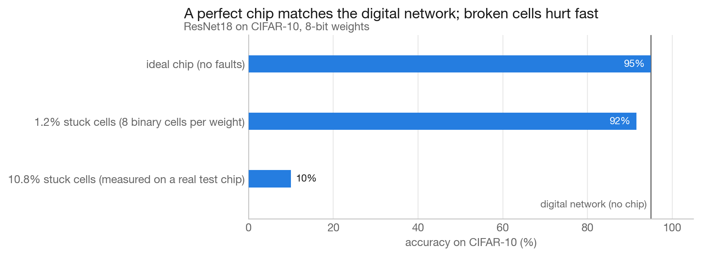

# Tutorial 1: Your First Chip Simulation

**Goal:** run a trained image classifier on a simulated RRAM chip, then break some memory cells and watch the accuracy drop.
**Time:** 10 minutes. **Hardware:** any laptop (CPU is fine).
**New terms:** conductance, differential pair, stuck-at fault, programming error, drift. See [Concepts](../concepts.md) sections 1-3.

## Step 1: Install

```bash
git clone https://github.com/SoyedTuhinAhmed/PyRRAM-Sim.git
cd PyRRAM-Sim
pip install torch torchvision
```

## Step 2: Run the network on a perfect chip

```bash
python main.py --dataset-path ./data --n-levels 256
```

The first run downloads the CIFAR-10 test images (about 170 MB) into `./data` and a ResNet18 trained on them. Then it evaluates the network twice: once normally (digital) and once with its weights stored on a simulated chip with 256 levels per cell and two cells per weight. You should see:

```
Baseline Digital Accuracy: 94.98%
Final RRAM Accuracy: 94.99%
```

(The last digit can differ slightly on a GPU.) The two numbers are the same: a chip without errors computes what the computer computes. This is the first check that the simulator is right.

## Step 3: Break some cells

A test chip measured in the literature had about 10.8% broken cells: 9.04% stuck at the highest conductance and 1.75% stuck at the lowest. Simulate that chip:

```bash
python main.py --dataset-path ./data --n-levels 256 \
    --apply-stuck-at --p-on 0.0904 --p-off 0.0175 --fault-seed 1
```

The accuracy falls to **10%**, which is random guessing for 10 classes. A stuck cell moves its weight by a large part of the weight range, and with two cells per weight about one weight in five is hit. `--fault-seed 1` fixes which cells break, so you get the same broken chip every time.

Now try the repair trick, `--compensate`: when one cell of a pair is stuck, its partner is reprogrammed to make up for it.

```bash
python main.py --dataset-path ./data --n-levels 256 \
    --apply-stuck-at --p-on 0.0904 --p-off 0.0175 --fault-seed 1 --compensate
```

It is not enough at this fault rate (still about 10%): pairs with both cells stuck cannot be repaired, and many weights hit the edge of the range. This is why the papers in tutorial 2 train fault-tolerant experts.

## Step 4: Fewer broken cells

With 1.2% broken cells, and each weight split over eight 1-bit cells, the network loses only about 3 points:

```bash
python main.py --dataset-path ./data --n-levels 2 --cells-per-weight 8 \
    --apply-stuck-at --p-on 0.01 --p-off 0.002
```



## Step 5: Add the other errors

Add programming error, relaxation and drift (defaults: 3%, 7% and 20%; see the [Reference](../reference.md#supported-non-ideality-models) for what each number means):

```bash
python main.py --dataset-path ./data --n-levels 256 --apply-prog-error --apply-relaxation --apply-drift
```

Change one value at a time to see which error hurts most, for example `--relative-drift 0.05` or `--prog-alpha-ind 0.01`. All flags are listed by `python main.py --help`.

## Step 6: Use your own network from Python

Everything above is also available in Python, for any PyTorch model:

```python
import sys
sys.path.insert(0, "src")
from pytorchrram import PyRRAMSimulator
from helper import validate

# my_model, test_loader, criterion and device are your own
chip = PyRRAMSimulator(my_model, G_min=1e-6, G_max=100e-6, n_levels=256, differential=True)

chip.apply_stuck_at_faults(p_on=0.01, p_off=0.002, fault_seed=1)   # broken cells: before programming
chip.apply_programming_error(alpha_ind=0.03)                       # writing the weights
chip.apply_conductance_relaxation(alpha_ind=0.07)                  # settling after writing
chip.apply_relative_drift(relative_drift=0.2)                      # slow change over time

_, accuracy = validate(chip.analog_model, test_loader, criterion, device)
print(f"accuracy on the chip: {accuracy:.2f}%")
```

The order matters and follows the life of a real chip: broken cells exist from the factory, then the weights are written, then they relax and drift. To average over many random chips, use `chip.MC_simulate(...)`; see the [Reference](../reference.md#python-api).

## Things to try

1. Find the stuck-cell rate at which the accuracy drops below 90% (change `--p-on` and `--p-off`).
2. Compare `--diff-style one_sided` with the default `two_sided` at the same fault rate.
3. Run Step 3 with `--fault-seed 2`, `3`, `4`: how much does the accuracy change from chip to chip?

**Next:** [Tutorial 2](2_fault_tolerant_experts.md) protects the network against these broken cells.
