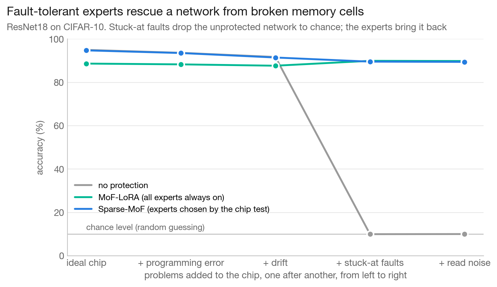

# Tutorial 2: Protect a Network with Fault-Tolerant Experts

**Goal:** train small "expert" add-ons that let a network survive a chip with broken cells, and compare two ways of using them.
**Time:** about 15 minutes on a laptop with a GPU (Apple M-series or NVIDIA), longer on a CPU.
**Papers:** MoF-LoRA [17] and HAT-FI [18] (see [references](../references.md)).
**New terms:** LoRA, expert, MoF-LoRA, Sparse-MoF, telemetry. See [Concepts](../concepts.md) section 5.

## The idea

In [tutorial 1](1_first_simulation.md) a chip with 10% broken cells destroyed the network. The papers behind this tutorial fix that with **experts**: small LoRA add-ons, one per problem.

| Expert | Trained against |
|---|---|
| `prog` | programming error |
| `drift` | drift |
| `saf` | the stuck cells of *this particular chip* (their positions are measured by a chip test) |
| `read` | read noise |
| `temp` | high temperature (optional) |

There are two ways to use them:

* **MoF-LoRA:** merge all experts into the weights before programming the chip. Simple, and costs nothing at run time.
* **Sparse-MoF** (from HAT-FI): first test the chip (how many stuck cells, how much drift, how noisy), then switch on only the experts the chip needs. A healthy chip runs with almost no correction; a damaged chip gets the full set.

## Step 1: Train and compare

```bash
python mof_main.py --dataset-path ./data --steps 200 --chips 2
```

This trains four experts for 200 steps each on CIFAR-10 (the temperature expert is skipped, with a note, unless you ask for it as in "Things to try") (the progress is printed as `[prog] step 200/200 loss=...`). Then it makes the chip worse step by step and measures each method on 2 simulated chips. The chip settings are: 3% programming error, 5% drift, 4% stuck cells (fault map `--fault-seed 1`) and 2% read noise.

## Step 2: Read the result

The last lines look like this:

```
condition         | unprotected           | mof-lora              | sparse-mof
clean             |  94.99 +- 0.00         |  88.67 +- 0.00         |  94.76 +- 0.00
                    Sparse-MoF experts per chip: [['prog'], ['prog']]
+prog             |  93.64 +- 0.05         |  88.31 +- 0.51         |  93.53 +- 0.01
...
+prog+drift+SAF   |  10.01 +- 0.01         |  89.94 +- 0.22         |  89.57 +- 0.31
                    Sparse-MoF experts per chip: [['prog', 'drift', 'saf'], ['prog', 'drift', 'saf']]
+read             |  10.06 +- 0.07         |  89.85 +- 0.23         |  89.45 +- 0.60
```

Each row adds one more problem to the chip; each column is a method (accuracy in %, average +- spread over the chips). The line under each row shows which experts Sparse-MoF switched on.



What it shows:

1. **The cliff.** Once the stuck cells are added, the unprotected network drops to 10%, random guessing.
2. **The rescue.** Both expert methods bring it back to about 90%.
3. **Why Sparse-MoF.** On a healthy chip, MoF-LoRA loses 6 points, because it always applies corrections for problems the chip does not have. Sparse-MoF switches on only `prog` there and keeps the full accuracy. It adds `drift` and `saf` only when its chip test detects them.

## Step 3: Reuse the experts

Save the experts once and test them on other chips without retraining:

```bash
python mof_main.py --dataset-path ./data --steps 200 --chips 2 --save-experts experts.pt
python mof_main.py --dataset-path ./data --load-experts experts.pt --p-saf 0.02
```

The `saf` expert learned the broken cells of the chip with `--fault-seed 1`. Try `--load-experts experts.pt --fault-seed 2`, a chip whose cells broke in *other* places: does the expert still help? (This is why HAT-FI tests every chip before choosing its experts.)

## Things to try

1. More training: `--steps 500`. Do the experts get better?
2. A hot chip: add `--temperature 85 --ea 0.1 --train-temperature 85` to train and test the temperature expert. `--ea` is the activation energy of the device in eV. It depends on the material, so the tool has no default and you have to choose it.
3. Only some methods: `--methods unprotected sparse-mof`.

All options: `python mof_main.py --help`. For using experts in your own Python code, see the [Reference](../reference.md#python-api).

**Next:** [Tutorial 3](3_llm_alignment.md) applies the same ideas to a language model.
