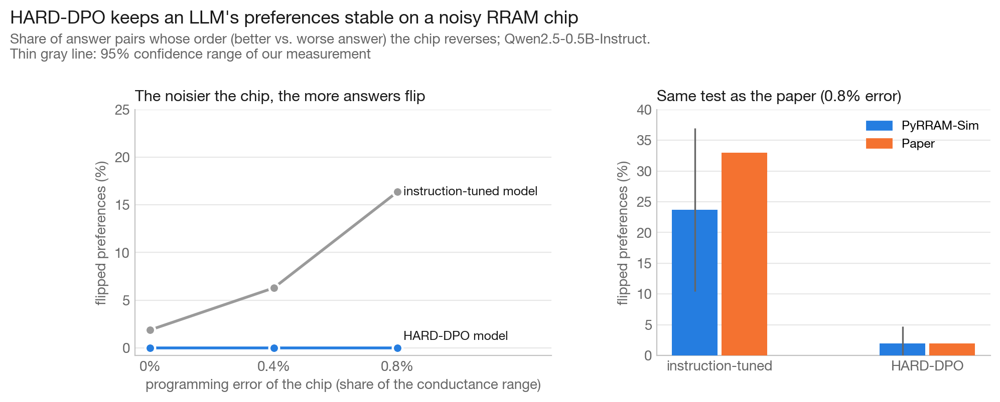

# Tutorial 3: Does an LLM Keep Its Judgement on a Chip? (Alignment and HARD-DPO)

**Goal:** measure how often a noisy RRAM chip reverses a language model's preferences, then train the model with HARD-DPO so that it stops happening.
**Time:** about 45 minutes on a laptop with 24 GB of memory (Apple M-series), faster on an NVIDIA GPU.
**Paper:** HARD-DPO [16] (see [references](../references.md)).
**New terms:** instruction-tuned model, preference pair, flip rate, DPO, weight clipping. See [Concepts](../concepts.md) sections 5 and 6.

## The idea

An instruction-tuned LLM has learned to prefer good answers. When its weights are stored on an RRAM chip, programming error changes them a little. That can be enough to make the model prefer the *worse* answer, even though the same model on a normal computer prefers the better one. HARD-DPO trains the model with simulated chip noise, so its preferences become hard to flip.

We test this with the small model Qwen2.5-0.5B-Instruct and preference pairs from the UltraFeedback dataset. Both are downloaded automatically the first time (about 1.4 GB; keep 3 GB of disk free).

## Step 1: Install

```bash
pip install torch transformers datasets
```

## Step 2: Measure the flip rate of the normal model

```bash
python llm_main.py eval --pairs 100 --chips 3 --alphas 0 0.004 0.008 \
    --max-length 1024 --low-memory --out base.json
```

What the options mean:

* `--pairs 100`: test 100 preference pairs. Two have very long prompts and are skipped, so 98 remain.
* `--alphas 0 0.004 0.008`: three chips of increasing programming error: none, 0.4% and 0.8% of the conductance range.
* `--chips 3`: three random chips per setting, to average out luck.
* `--low-memory`: saves memory on a laptop, at some cost in speed. Close other programs as well.

This takes about 15 minutes on an M-series laptop. The result:

```
 alpha   | flip rate (%)      | clean acc (%) | RRAM acc (%)
 0       |   1.89 +-  0.00 |  54.08        |  53.06
 0.004   |   6.29 +-  1.23 |  54.08        |  51.36
 0.008   |  16.35 +-  6.52 |  54.08        |  50.34
```

* **flip rate**: share of the pairs the chip reverses (+- is the 95% confidence range over the chips).
* **clean acc**: how often the model prefers the better answer on a normal computer.
* **RRAM acc**: the same on the chip.

Even with no programming error (`alpha` 0), 2% of the preferences flip, because the chip stores only 256 levels per cell. At 0.8%, one preference in six flips.

## Step 3: Train with HARD-DPO

```bash
python llm_main.py train-hard-dpo --steps 100 --train-batch 2 --max-length 512 \
    --max-prefs 2000 --gradient-checkpointing --out hard_dpo.pt
```

The model trains on preference pairs while simulated chip noise is added to its weights at every step. It prints its progress every 10 steps (`[HARD-DPO] step 10/100 loss=...`) and saves a small LoRA add-on, not a whole model. This short run (100 steps, about 15 minutes) is enough to see the effect; the paper trains for 1000 steps with batches of 4 (the defaults, if you leave out `--steps` and `--train-batch`), which needs a GPU.

## Step 4: Measure again

```bash
python llm_main.py eval --experts hard_dpo.pt --deploy merged --clip-sigma 3 \
    --pairs 100 --chips 3 --alphas 0 0.004 0.008 --max-length 1024 --low-memory --out hard_dpo.json
```

`--deploy merged` writes the add-on into the weights before they go to the chip. `--clip-sigma 3` cuts off the rare very large weights first, as in the paper.

```
 alpha   | flip rate (%)      | clean acc (%) | RRAM acc (%)
 0       |   0.00 +-  0.00 |  54.08        |  56.12
 0.004   |   0.00 +-  0.00 |  54.08        |  54.42
 0.008   |   1.26 +-  1.23 |  54.08        |  53.74
```

The flips are almost gone, and the model still prefers the better answer as often as before.



## Step 5 (optional): The paper's exact test

The paper evaluated with the protocol of its released scripts (other pairs, other conductance range, every layer on the chip). `--legacy-eval` switches to it:

```bash
python llm_main.py eval --legacy-eval --alphas 0.008 --chips 5 --batch-size 1 --max-length 2048 --low-memory
```

The instruction-tuned model flips about 24% of the pairs here (the paper reports about 33%; with only 5 chips our confidence range is wide). A HARD-DPO checkpoint trained with the original scripts flips 2% (paper: about 2%). To test such a checkpoint, add `--clip-sigma 3 --peft-adapter <checkpoint.pt> --lora-alpha 128 --deploy hybrid`.

## Things to try

1. A harder chip: `--alphas 0.012 0.016`.
2. Is the clipping or the training doing the work? Run Step 4 with `--clip-sigma 3` but without `--experts`.
3. A bigger model: `--model Qwen/Qwen2.5-1.5B-Instruct` (needs more memory; use a GPU).

All options: `python llm_main.py eval --help` and `python llm_main.py train-hard-dpo --help`.

**Next:** [Tutorial 4](4_llm_performance.md) puts the LLM on a chip with broken cells and drift, and rescues it with experts.
