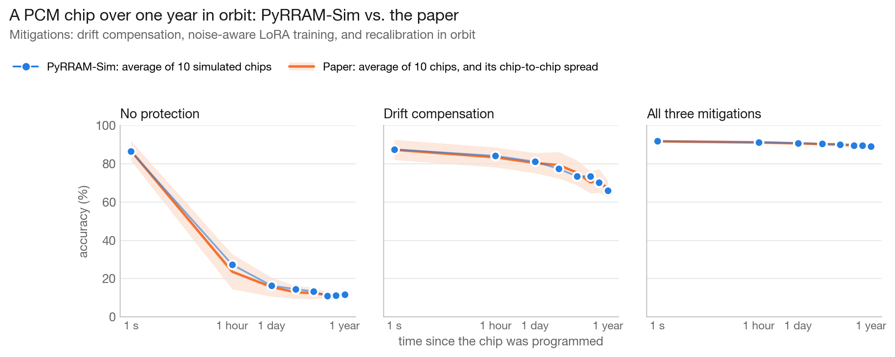

# Tutorial 5: AI in Space, a Year in Orbit for an Analog Chip

**Goal:** run a satellite-image classifier on simulated analog memory chips through one year in orbit, and reproduce the case study of the Space Data Centers paper [25].
**Time:** a 15-minute check on one GPU; the full reproduction takes about 3.5 hours on 8 GPUs.
**Hardware:** Linux with one or more NVIDIA GPUs (24 GB each was used; smaller ones work, see [Troubleshooting](#troubleshooting)). About 10 GB of disk.
**New terms:** drift, single-event upset, total ionizing dose, drift compensation, recalibration. See [Concepts](../concepts.md) sections 3-5.

## The story

A satellite takes multispectral images of the Earth and labels each one with its land use (forest, river, highway, ...; the EuroSAT dataset, 10 classes). The classifier is Presto, a small transformer for satellite data. To save energy, it runs on an in-memory computing chip, which is programmed once on the ground and then flies for a year.

In orbit, three things degrade the stored weights:

* **Drift:** in PCM, the conductances slowly shrink after programming.
* **Radiation:** particles flip single cells (*upsets*), and the absorbed *dose* makes the chip noisier.
* **Temperature:** heat speeds up drift and adds noise.

The paper tests three protections:

1. **Noise-aware LoRA** (on the ground): train the model with simulated chip noise.
2. **Drift compensation** (automatic, in orbit): measure how much the outputs have shrunk and scale them back.
3. **Recalibration** (in orbit): retrain only the last layer and the normalization layers on 250 labeled images.

The questions are: how much does each protection help, and which memory (PCM, ReRAM, SONOS) survives best?

## Step 0: Set up

```bash
git clone https://github.com/SoyedTuhinAhmed/PyRRAM-Sim.git && cd PyRRAM-Sim
bash scripts/sdc_coins26/00_setup.sh
```

This creates a Python environment in `.venv/` with PyTorch and the packages for reading satellite images. If you already have a Python environment with PyTorch, run `PY=/path/to/python bash scripts/sdc_coins26/00_setup.sh --no-venv` instead and put `PY=/path/to/python` in front of every later script. Everything the scripts write goes to `sdc_work/` (set `SDC_WORK=/other/folder` to change it).

## Step 1: Download the data

```bash
bash scripts/sdc_coins26/01_download.sh
```

This downloads the EuroSAT images (27,000 images, about 2 GB), the official split into training, validation and test images, and the pretrained Presto model.

## Step 2: Prepare the images

```bash
bash scripts/sdc_coins26/02_build_cache.sh
```

This reads every image once and stores them in one fast file (about a minute).

## Step 3: Check that everything works (3 minutes)

```bash
bash scripts/sdc_coins26/smoke_test.sh
```

This runs the whole pipeline on 300 images with almost no training, so the accuracies are meaningless. It passes when the last line says `smoke test passed`. Even here you can see the main effect: the unprotected chip drops to chance level (10%) within a day.

## Step 4: Get the trained models

Every *seed* (random repetition, see [Concepts](../concepts.md) section 7) needs two trained models:

* **E0:** Presto fine-tuned on EuroSAT (normal training).
* **E2:** E0 trained further with noise-aware LoRA.

Train them for 10 seeds (about 1.5 hours on 8 GPUs; one seed per GPU at a time):

```bash
bash scripts/sdc_coins26/03_train.sh
bash scripts/sdc_coins26/03_train.sh --seeds 0,1 --gpus 0,1      # or fewer seeds and GPUs
```

At the end it prints the test accuracy of each model; the paper's models reach about 96% (E0) and 90% (E2). On the paper's hardware the script recreates the paper's E0 models exactly.

**Already have the paper's models?** Skip training and tell the scripts where they are (`{seed}` is replaced by the seed number; `*` is allowed):

```bash
export E0_PATTERN='/path/to/results/e0_finetune/*_seed{seed}/checkpoints/best.pt'
export E2_PATTERN='/path/to/results/e2_lora/*_seed{seed}/checkpoints/merged.pt'
```

## Step 5: Fly the missions

Start small, with Fig. 2 of the paper and one seed (5 jobs, about 10 minutes on 8 GPUs):

```bash
bash scripts/sdc_coins26/04_missions.sh --figures fig2 --seeds 0
```

Then everything (Figs. 2-8, 188 jobs, about 2 hours on 8 GPUs):

```bash
bash scripts/sdc_coins26/04_missions.sh
```

Each job takes one *configuration* (one chip and protection setting, see the table below) and one seed. It programs the chip, then reads it after 1 second, 1 hour, 1 day, 1 week, 1 month, 3, 6 and 12 months, and measures the accuracy on the 5,400 test images each time. Results go to `sdc_work/results/`. If the run stops, start the same command again: finished jobs are skipped.

By default the expensive figures use fewer seeds than the paper's 10 (5 for Fig. 5, 2 for Figs. 6-8). `--full` uses 10 everywhere (about 5.5 hours on 8 GPUs).

`--fused` makes the recalibration step (used by `E4` and the other configurations with recalibration) about 15% faster. The results stay the same up to seed-to-seed variation.

## Step 6: Compare with the paper

```bash
bash scripts/sdc_coins26/05_report.sh
```

It compares every number with the paper's value (the paper's values ship with the code) and prints one summary line:

```
532 points compared with the paper: ... |z| < 2 for 95%, |z| < 3 for 99%
```

**"|z| < 2 for 95%" is the headline: 95% of the paper's numbers are reproduced within seed-to-seed variation.** That is the best possible score: even two runs of the same simulator with different seeds agree on only about 95% of the points by this test. The full table is in `sdc_work/results/summary.txt` (one line per point: our average, the paper's average and spread, and `z` = the difference measured in standard errors). The figures go to `sdc_work/figures/`.

This is what the reproduction looks like:



More figures and the explanation of the remaining differences: [Reproducing the papers](../reproducing_the_papers.md#space-data-centers-coins-2026).

## The configurations

Each configuration has a short name from the paper:

| Name | Chip | Protection |
|---|---|---|
| `E1a`, `E1b` | PCM | none (`E1a` without radiation, `E1b` with it) |
| `E2` | PCM | noise-aware LoRA |
| `E3` | PCM | noise-aware LoRA + drift compensation |
| `E4` | PCM | all three (the "fully protected" chip) |
| `E3_noLoRA`, `E4_noLoRA` | PCM | as `E3` and `E4`, without noise-aware LoRA |
| `E4_head` | PCM | as `E4`, recalibrating only the last layer |
| `P1Y`...`P4Y`, `R1Y`...`R4Y`, `RP1Y`...`RP4Y`, `S1Y`...`S4Y` | PCM, ReRAM (1 cell per weight), ReRAM (2 cells per weight), SONOS | steps 1-4: none, + LoRA, + drift compensation, + recalibration |
| `D1`...`D4` | PCM | steps 1-4, at radiation doses from 0.1 to 3,000 krad(Si) |
| `T1`...`T4` | PCM | steps 1-4, at temperatures from -100 to 125 °C |
| `RPD1`, `RPD4`, `SD1`, `SD4`, `SX1`, `SX4` | ReRAM (2 cells), SONOS, SONOS with charge loss | steps 1 and 4, against radiation dose |

| Figure of the paper | Configurations |
|---|---|
| Fig. 2 | `E1a`, `E1b`, `E2`, `E3`, `E4` |
| Fig. 3 | `E3_noLoRA`, `E4_noLoRA`, `E4_head` |
| Fig. 4 (10x and 100x more radiation upsets) | included in the Fig. 2 and 3 runs |
| Fig. 5 | `P*Y`, `R*Y`, `RP*Y`, `S*Y` |
| Fig. 6 | `D1`, `D4`, `RPD*`, `SD*`, `SX*` |
| Fig. 7 | `D1`-`D4` |
| Fig. 8 | `T1`-`T4` |

The physics behind each one is described in the [Reference](../reference.md#space-environment-and-mission-models).

## Run one configuration yourself

The scripts call `space_main.py`, which you can use directly:

```bash
# E4 and E4_noLoRA for seeds 0 and 1
python space_main.py mission --cache-dir sdc_work/cache --configs E4 E4_noLoRA --seeds 0 1 \
    --e0 'sdc_work/checkpoints/e0_seed{seed}.pt' --e2 'sdc_work/checkpoints/e2_seed{seed}.pt' \
    --compile --out my_results.jsonl

# your own radiation doses
python space_main.py mission ... --configs D4 --sweep-values 10 100 1000 --out dose.jsonl

# a quick look on a tenth of the test images
python space_main.py mission ... --configs E1a --test-limit 540 --out quick.jsonl

# compare with the paper and draw the curves
python space_main.py summarize my_results.jsonl
python space_main.py plot my_results.jsonl --out-dir figures
```

Each line of a result file is one measurement, for example `"config": "E4", "seed": 0, "t_label": "12mo", "accuracy": 0.8957, "seu_hits": 274`. Here `seu_hits` is the number of cells hit by radiation so far.

## Settings

All scripts read their settings from environment variables (defaults in `scripts/sdc_coins26/config.sh`):

| Variable | Default | Meaning |
|---|---|---|
| `SDC_WORK` | `<repo>/sdc_work` | Folder for everything the scripts write |
| `PY` | `.venv/bin/python`, else `python3` | Python to use |
| `GPUS` | all GPUs | e.g. `GPUS="0 1 2 3"`; or `--gpus 0,1` |
| `SEEDS` | `0 1 ... 9` | Seeds for training and for Figs. 2-4 |
| `FIGURE_SEEDS` | `fig5=0,1,2,3,4 fig6=0,1 fig7=0,1 fig8=0,1` | Fewer seeds for the expensive figures |
| `FIGURES` | `fig2 fig3 fig5 fig6 fig7 fig8` | Figures to run |
| `E0_PATTERN`, `E2_PATTERN` | `sdc_work/checkpoints/e{0,2}_seed{seed}.pt` | Trained models to use |
| `EUROSAT_ZIP`, `PRESTO_WEIGHTS` | under `sdc_work/data` | Files you already have |
| `EVAL_BATCH` | 39 images | Lower it on GPUs with less memory |

## Troubleshooting

* **`torch.compile` fails** with an ImportError or "Permission denied": the folder for compiled code does not allow programs to run. Set `TORCHINDUCTOR_CACHE_DIR` and `TRITON_CACHE_DIR` to another folder, or add `--no-compile` to `04_missions.sh` (about 2x slower).
* **CUDA out of memory:** `EVAL_BATCH=16 bash scripts/sdc_coins26/04_missions.sh`. The batch size does not change the results.
* **A job failed:** read `sdc_work/results/<config>_seed<k>.log`, fix the cause, and run `04_missions.sh` again; only unfinished jobs rerun.
* **"No checkpoint for seed k":** train that seed with `03_train.sh --seeds k`, or run fewer seeds with `--seeds`.
* **The download fails:** download `EuroSATallBands.zip` by hand (Hugging Face `torchgeo/eurosat`, or `EuroSAT_MS.zip` from Zenodo record 7711810) and run `EUROSAT_ZIP=/path/to/file.zip bash scripts/sdc_coins26/01_download.sh`.
* **Your login shell is csh or tcsh:** always start the scripts with `bash script.sh`, as shown.
